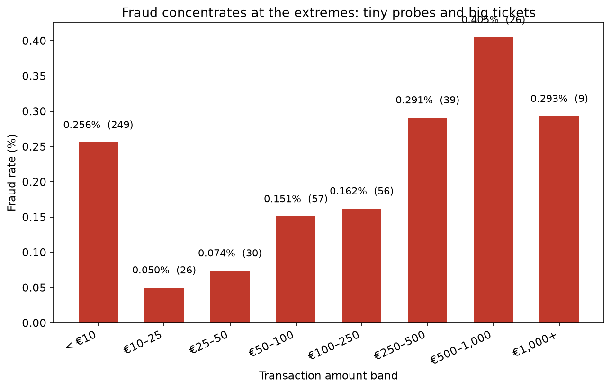

# Credit Card Fraud Detection

**One-line pitch:** A card issuer sees 284,807 transactions in two days and 492 of them are fraud — how do you catch the fraud without drowning the review team in false alerts?

**Business question:** A card issuer has to decide, for each transaction, whether to approve it, block it, or send it to a human analyst. Block a fraud and the transaction amount is saved; block a good customer and you pay analyst time plus the customer's trust. With fraud at 0.17% of transactions, a model that is "99% accurate" can still be useless — which transactions are actually fraud, and what does each alert cost?



## Key findings

- **Fraud is 1 in 579 — and accuracy is a trap.** Only **492 of 284,807 transactions (0.1727%)** are fraud, worth **€60,128 of €25.16M** transacted. Predicting "legitimate" for every transaction scores **99.85% accuracy and catches €0 of fraud**. The honest metrics are precision, recall and euros.
- **Half the frauds are tiny probes.** **249 of 492 frauds (50.6%) are under €10** — small test purchases before the card is used for real — but they are worth only €459 in total. The highest fraud *rate* is the €500–1,000 band (**0.405%**). Fraud's median amount is **€9.25 vs €22.00** for legitimate transactions. A minimum-amount floor for scoring would hand fraudsters a free testing ground.
- **Fraud is a night-time problem.** The fraud rate at hours 00–05 is **0.518% vs 0.124% in the evening — 4.2x higher** — and hour 02 alone hits **1.71%** (57 frauds in 3,328 transactions). Hours are relative to the first transaction in the file, not clock time.
- **The signal is concentrated in a few anonymised features.** V14 separates fraud from legitimate with a standardised mean difference of **−2.26**, followed by V4 (+2.01), V11 (+1.88) and V12 (−1.87). In the random forest, V14 alone carries ~20% of the importance, then V10 and V17. The V-features are PCA components, so they carry signal but no business meaning.
- **The threshold matters more than the algorithm.** A random forest trained on day 1 and tested on day 2 (a time-based split) scores **ROC-AUC 0.957, average precision 0.792** and, at its tuned threshold, **precision 0.872 / recall 0.777 / F1 0.822 — 188 alerts, 164 frauds caught, 24 false alerts**. Logistic regression at the default 0.50 threshold is unusable: **4,929 alerts, 96% of them false** (precision 0.037). Tuning the threshold on training data alone fixes it (precision 0.644, recall 0.730).
- **In euros, the random forest pays.** On day 2 (€26,889 of fraud value) it catches **€17,233 (64.1%)** at a cost of 24 false alerts × €15 = €360, for a **net benefit of €16,873**. Logistic regression catches €15,950 (59.3%) for a net €14,675. No model catches €0.

## Data source and size

- **Source:** Kaggle dataset "Credit Card Fraud Detection" (`mlg-ulb/creditcardfraud`), file `creditcard.csv`, downloaded 2026-11-20 from the public TensorFlow mirror of the same file (`https://storage.googleapis.com/download.tensorflow.org/data/creditcard.csv`, 150.8 MB) because the Kaggle API endpoint requires a Kaggle account. Row and fraud counts were verified on load against the canonical 284,807 / 492.
- **Size:** 284,807 transactions, 31 columns (Time, V1–V28, Amount, Class). 1,081 exact duplicate rows kept (see notes/cleaning_notes.md); 0 nulls.
- **Coverage:** European cardholders, two days in September 2013. Time is seconds since the first transaction in the file.

## Tools used

- **DuckDB** — loading and all EDA (SQL with CTEs, window functions, filtered aggregates)
- **SQL** — 11 queries across `sql/02_metrics.sql` … `sql/04_features.sql`
- **Python (pandas, matplotlib, scikit-learn)** — EDA notebook, charts, logistic regression + random forest
- **HTML** — static dashboard (`dashboard/index.html`); spec for a Power BI / Tableau build in `dashboard/DASHBOARD_SPEC.md`

## Approach

1. **Load** the 150 MB CSV into DuckDB (`sql/01_load.sql`, run via `python3 load.py`). Raw file is git-ignored; the database rebuilds from the script.
2. **Clean** — nothing to impute (0 nulls); 1,081 duplicate rows kept deliberately so every number matches the canonical dataset. Hour and day are derived from Time; amount bands are defined once in `sql/01_load.sql`. Every decision is documented in `notes/cleaning_notes.md`, with QA checks in `load.py`.
3. **Analyse in SQL** — headline KPIs and class balance, fraud by amount band and by hour, and which V-features separate fraud (standardised mean difference / Cohen's d).
4. **Model with a time-based split** — train on day 1 (144,786 transactions, 281 frauds), test on day 2 (140,021 transactions, 211 frauds). A random split would leak: fraud patterns drift within hours, and a model that has "seen the future" flatters itself. Features: V1–V28 + log(Amount) + hour. Both models are class-weighted.
5. **Tune the threshold on training data only** — the alert threshold maximises F1 on 3-fold out-of-fold predictions from day 1, then is applied untouched to day 2. The default 0.50 threshold is reported alongside to show what happens without this step.
6. **Price the result** — a missed fraud costs its full amount; a false alert costs €15 of analyst time (assumption, stated everywhere it is used). Net benefit is reported per model on day 2.
7. **Visualize** — fraud rate by amount band and by hour, amount distributions, precision–recall curves, confusion matrix, feature importance (`notebooks/01_eda.ipynb`, charts in `images/`).

## Recommendations

- **Ship the random forest at the tuned threshold (0.24), not 0.50** — 188 alerts a day at this volume, 87% of them real fraud, 64% of fraud value caught. At 0.50 it catches less fraud (65% recall) for a similar alert count; logistic regression at 0.50 is unusable (4,929 alerts, 96% false).
- **Score small transactions too.** Half of all frauds are under €10. A minimum-amount floor for scoring would hand fraudsters a free testing ground — the probes are the signal that a card is compromised.
- **Tighten overnight (00–05 relative hours).** Fraud rate is 4.2x the evening rate; route overnight transactions through the model first and hold the highest-risk ones for review instead of auto-approving.
- **Retrain daily on a rolling window.** Fraud patterns drift within hours; the random forest's F1 slips from 0.88 out-of-fold on day 1 to 0.82 on day 2. Never evaluate on a random split.
- **Never report accuracy.** "Predict everything legitimate" scores 99.85% and catches €0. Precision, recall, average precision and euros are the scoreboard.
- **Price the threshold with your own false-alert cost.** €15 is an analyst-time assumption; at €50 per alert the tuned threshold is too aggressive and the net benefit falls. The cost table in `dashboard/05_cost_model.csv` is built to be re-run with your number.

## Repository structure

```
credit-card-fraud-detection/
├── README.md
├── load.py                # builds data/transactions.duckdb from the CSV + QA checks
├── run_analysis.py        # runs sql/02–04, saves dashboard/*.csv
├── .gitignore
├── data/
│   ├── raw/               # creditcard.csv (git-ignored, 151 MB)
│   └── transactions.duckdb  # built database (git-ignored)
├── sql/
│   ├── 01_load.sql        # raw load + transactions table + day/hour/amount_band
│   ├── 02_metrics.sql     # headline KPIs, amounts by class, fraud by day
│   ├── 03_amount_time.sql # fraud by amount band, by hour, by hour band
│   └── 04_features.sql    # standardised mean difference (Cohen's d) for V1–V28
├── notebooks/
│   ├── 01_eda.ipynb       # EDA with embedded charts
│   ├── build_notebook.py  # regenerates the notebook + charts + models
│   ├── fix_feature_importance.py  # one-off fix for a mis-titled chart (see below)
│   └── model_results.txt  # model metrics + cost model (day-2 test set)
├── dashboard/
│   ├── index.html         # static dashboard (open in a browser)
│   ├── DASHBOARD_SPEC.md  # Power BI / Tableau build spec
│   └── *.csv              # query outputs backing the dashboard
├── images/                # charts (amount band, hour, distribution, PR curve, confusion matrix, importance)
└── notes/
    └── cleaning_notes.md  # every cleaning decision + QA results
```

## How to reproduce

```bash
git clone https://github.com/Saikrishna-469/credit-card-fraud-detection.git
cd credit-card-fraud-detection
pip install duckdb pandas matplotlib scikit-learn nbformat

# 1. Download the data (Kaggle "Credit Card Fraud Detection", 150 MB)
mkdir -p data/raw
cd data/raw
curl -L -o creditcard.csv "https://storage.googleapis.com/download.tensorflow.org/data/creditcard.csv"
# (same file as the Kaggle download; the Kaggle API endpoint needs an account)
cd ../..

# 2. Load into DuckDB (builds data/transactions.duckdb, runs QA checks)
python3 load.py

# 3. Run the analysis (prints results, saves dashboard/*.csv)
python3 run_analysis.py

# 4. Rebuild the notebook, charts and models
python3 notebooks/build_notebook.py

# 5. Open the dashboard
open dashboard/index.html
```

## Limitations

- **Two days only, September 2013.** Fraud patterns, volumes and the cost model are a 48-hour snapshot. Fraud tactics, card technology (chip, 3-D Secure, tokenisation) and the transaction mix have all changed since. The *method* — time-based split, precision/recall at a tuned threshold, cost per alert — transfers; the *levels* do not.
- **"Hour" is relative, not clock time.** Time is seconds since the first transaction in the file; no start timestamp is given. The overnight pattern is real relative to the cardholders' day, but the absolute clock hours are unknown — do not quote "2 a.m." as a finding.
- **V-features are uninterpretable by design.** V1–V28 are PCA components; V14 cannot be translated back into "card-present" or "online". Any business rule built on them needs the PCA pipeline behind it, not a story about the feature.
- **No customer or merchant fields.** There is no cardholder id, merchant, country or device, so velocity features (transactions per card per hour), merchant risk and device fingerprints — the strongest signals in a real fraud system — cannot be built here. The model is a transaction-level scorer only.
- **The €15 false-alert cost is an assumption.** It prices analyst review time per alert. The real cost includes customer friction (a blocked good customer) and differs by issuer; re-run the cost table with your own number before quoting savings.
- **Fraud € is small in this sample** (€60,128 over two days) because the sample is small and European 2013 fraud was mostly low-value testing. Scale the cost model to your own volume before quoting savings.
- **One chart was re-titled after the first build.** The first run of `build_notebook.py` titled the feature-importance chart "V14, V4 and V12 carry most of the fraud signal"; the trained forest actually ranks V14, V10, V17 first. The chart and the notebook were regenerated with the correct title by `notebooks/fix_feature_importance.py`; the script is kept in the repo so the correction is auditable. No numbers changed.
